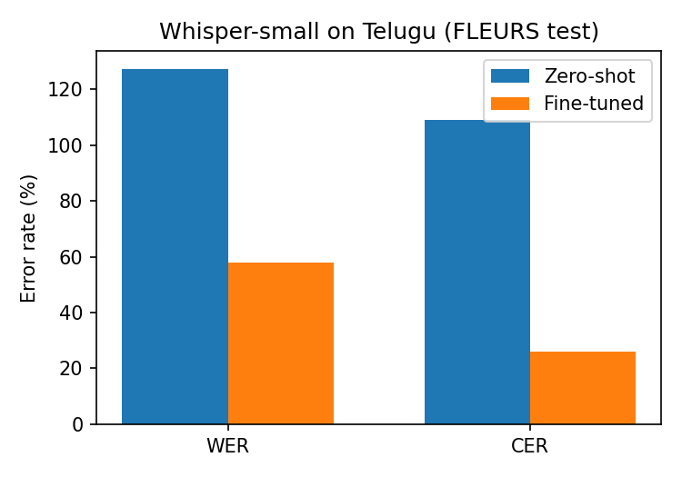

# whisper-telugu-asr
Telugu speech recognition: fine-tuned Whisper-small, evaluated with WER/CER on FLEURS.

# Fine-tuning Whisper for Telugu Speech Recognition

Fine-tunes `openai/whisper-small` on Telugu speech from Google FLEURS and measures
Word Error Rate (WER) and Character Error Rate (CER) before and after fine-tuning.

## Setup
- **Model:** openai/whisper-small (244M parameters)
- **Data:** google/fleurs, `te_in` config. 1,500 training utterances, 200 test utterances
- **Training:** 600 steps, effective batch size 16, learning rate 1e-5, fp16, single free Colab T4 GPU
- **Metrics:** WER and CER (jiwer) on the held-out FLEURS test subset

## Results

| Model | WER (%) | CER (%) |
|---|---|---|
| Whisper-small, zero-shot | 127.43 | 109.15 |
| Whisper-small, fine-tuned | 57.85 | 26.02 |

Zero-shot error rates above 100% mean the model inserted many extra or wrong words
(for example repeated or hallucinated text) on top of its mistakes. After fine-tuning,
WER dropped by about 69.6 points and CER by about 83.1 points on the same test subset.
Full numbers are in `results.json`.

## Run it
1. Open `whisper_telugu_finetune.ipynb` in Google Colab (File -> Upload notebook).
2. Runtime -> Change runtime type -> **T4 GPU**.
3. Runtime -> Run all (about 45-60 minutes).
4. Download `results.json` and `wer_comparison.png`, then update the table above.

## Notes and limitations
- Small training subset and short schedule, so this is a proof of concept, not a state-of-the-art system.
- Evaluated on a 200-utterance subset of the FLEURS test split.
- Possible extensions: more data (Common Voice, IndicVoices), Whisper-medium or LoRA, text normalization for Telugu, comparison with wav2vec2/IndicWav2Vec, a Gradio demo.
